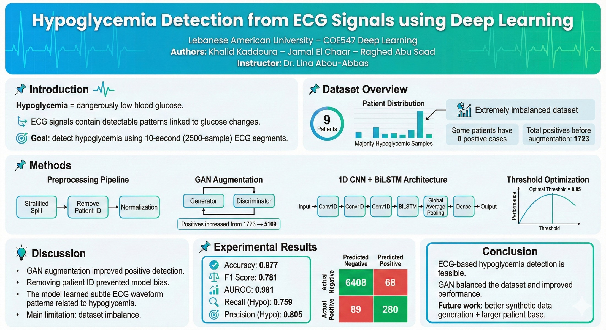

# Hypoglycemia Detection from ECG with CNN–BiLSTM and GAN Augmentation

Can a 10-second ECG segment reveal low blood sugar? This project detects hypoglycemia from non-invasive ECG signals with a 1D CNN + BiLSTM classifier. Only about 5% of segments were hypoglycemic, so a GAN generates synthetic positive segments to counter the imbalance.

<p align="center"></p>

**Course:** COE 547 Deep Learning, Lebanese American University (Fall 2025)
**Team:** Khalid Kaddoura, Jamal El Chaar, Raghed Abu Saad

## What I did

- Designed and trained the 1D CNN + BiLSTM classifier on raw 2,500-sample ECG segments.
- Trained a GAN to generate synthetic hypoglycemic segments, raising the positives from 1,723 to about 5,169.
- Tested alternatives (a feature-based MLP, TimeGAN, patient-wise splits) and tuned the decision threshold for the best F1.

## Data

ECG recordings from 9 patients across several days, cut into 10-second segments of 2,500 samples, each labeled normal (0) or hypoglycemic (1). The data is highly imbalanced: 30,218 normal vs 1,723 hypoglycemic segments, and some patients have no hypoglycemic events at all.

The dataset is not included in this repository. Place `ECG_10s_2500.csv` in a `data/` folder (or update the path at the top of each notebook; the Colab notebooks read it from Google Drive).

## Method

1. **Preprocessing.** Per-segment z-score normalization; the patient ID column is dropped so the model learns from the ECG itself rather than patient identity.
2. **Split.** Stratified train/validation/test split that keeps the class ratio in every set.
3. **GAN augmentation.** A 1D-convolutional generator and discriminator are trained on the hypoglycemic segments only; the generator then produces synthetic positives (discriminator scores: real 0.91, fake 0.11).
4. **Classifier.** Three Conv1D blocks (32, 64, 128 filters) → BiLSTM (64 units) → global average pooling → dense layers; 180,161 parameters.
5. **Threshold tuning.** The threshold is swept from 0.05 to 0.95 on the validation set and the best-F1 value (0.85) is used for testing.

## Results

| Metric | Final (GAN) | Baseline (no GAN) | TimeGAN |
|---|---|---|---|
| F1 (hypoglycemia) | **0.781** | 0.752 | 0.732 |
| AUROC | **0.981** | 0.974 | 0.981 |
| Recall | **0.759** | 0.740 | 0.720 |
| Precision | **0.805** | 0.765 | 0.745 |
| Accuracy | **0.977** | 0.974 | 0.971 |

Confusion matrix on the test set (threshold 0.85):

| | Predicted normal | Predicted hypo |
|---|---|---|
| **True normal** | 6,408 | 68 |
| **True hypo** | 89 | 280 |

**On evaluation:** these results use a stratified random split, so segments from the same patient can appear in both training and test sets. Stricter leave-one-patient-out splits were also tried (see `notebooks/experiments/`), but with so few positive events per patient the model could not learn to detect hypoglycemia. A feature-based MLP reached about 0.60 F1.

## Repository structure

```
notebooks/
  01_data_exploration.ipynb        dataset loading and class balance
  02_baseline_cnn_bilstm.ipynb     CNN–BiLSTM without GAN augmentation
  03_final_gan_cnn_bilstm.ipynb    final pipeline: GAN augmentation + CNN–BiLSTM
  experiments/
    gan_variant_cnn_bilstm.ipynb   alternative GAN setup
    leave_one_patient_out_v1.ipynb patient-wise evaluation attempts
    leave_one_patient_out_v2.ipynb
docs/   report, poster, proposal and background notes
media/  images used in this README
```

## How to run

```bash
pip install -r requirements.txt
jupyter notebook notebooks/03_final_gan_cnn_bilstm.ipynb
```
The notebooks were developed in Google Colab with a GPU; training the GAN and classifier on CPU is slow.

## Tools

Python · TensorFlow / Keras · scikit-learn · pandas · NumPy · Google Colab

## Documentation

- [Report (PDF)](docs/Report.pdf)
- [Poster](docs/Poster.png)
- Portfolio: [khalidkadd1.github.io](https://khalidkadd1.github.io)
